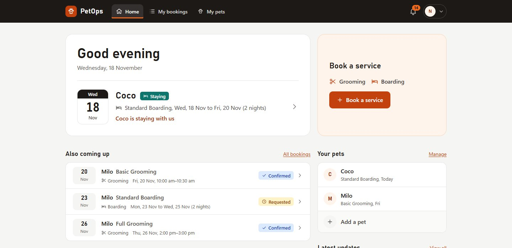
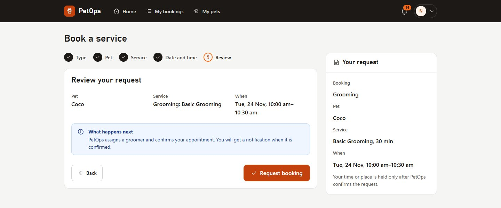
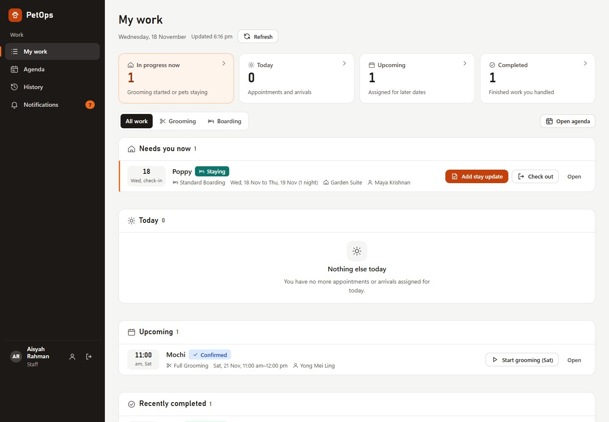
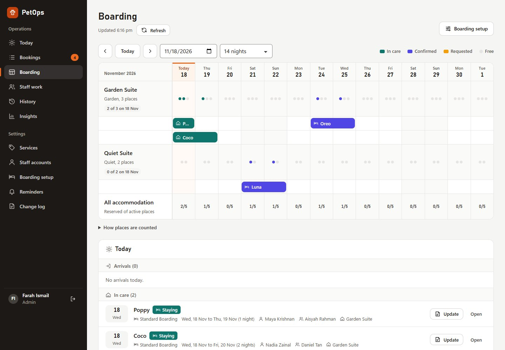
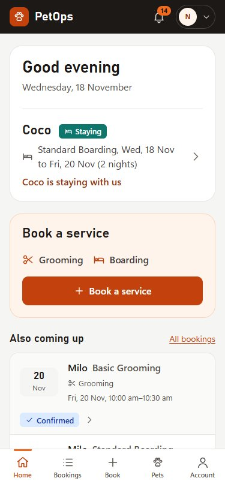
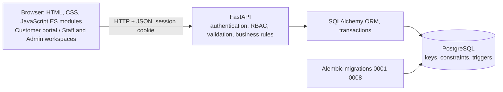

# PetOps

PetOps is a web-based **Grooming and Boarding booking and management system** for three roles: **Customer, Staff and Admin**. It was developed as my Final Year Project (FYP1, Bachelor of IT (Information Systems), Universiti Tenaga Nasional), using the RS Pet House case study.

It is an **academic prototype that runs locally with fictional data**. It is not a deployed or commercial service.

[Walkthrough](demo/README.md) · [Local setup](docs/developer/SETUP.md) · [Workflows](docs/workflows/README.md) · [Architecture](docs/architecture/README.md) · [Database](docs/database/README.md) · [Insights definitions](docs/analysis/KPI_SEMANTICS.md) · [Testing](docs/testing/README.md) · [Limitations](docs/testing/LIMITATIONS.md) · [Release identity](docs/RELEASE.md)

## Why it exists

At the case business, advance Boarding reservations and cage availability were handled by hand, while Customer, pet and stay details sat in a separate record application. PetOps connects these steps in one structured record: the request, resource preparation, service work and retained history.

## Final frozen build

| | |
|---|---|
| Services | Grooming, Boarding |
| Roles | Customer, Staff, Admin |
| Database | PostgreSQL, Alembic migration head `0008`, 17 application tables |
| Automated regression | **433 passed / 0 failed** on PostgreSQL 18.6 (plus 4 nested subtests; 1 pre-existing dependency warning) |
| Browser end-to-end checks | **13 / 13 passed** |
| Independent technical review | Passed with one condition; the condition was corrected and closed on re-review |
| Frozen source identity | 146 source files, SHA-256 `1fd06edf1788176a09d9c3d93c3a28413a55a006f53f6210652fd14087048e70` ([details](docs/RELEASE.md)) |

These are **technical verification results**. They are not human user-acceptance testing, usability measurement or production certification.

## Screenshots (fictional data)

<table>
<tr>
<td width="50%" align="center"> <strong>Customer Home</strong> Next booking, what happens next, pets and updates.</td>
<td width="50%" align="center"> <strong>Booking journey</strong> Type, Pet, Service, Date and time, Review.</td>
</tr>
<tr>
<td align="center"> <strong>Staff: My work</strong> Own jobs only, one next action each.</td>
<td align="center"> <strong>Admin: Today</strong> Needs decision, today's work, capacity, Staff workload.</td>
</tr>
<tr>
<td align="center"> <strong>Admin: Boarding lodging board</strong> Reserved places per unit and night.</td>
<td align="center"> <strong>Admin: Insights</strong> Period measures with comparison and drill-down.</td>
</tr>
<tr>
<td align="center"> <strong>Phone width (375 px)</strong></td>
<td align="center"> <strong>Phone width (375 px)</strong></td>
</tr>
</table>

[Full gallery and capture notes](assets/README.md)

## Core workflow

Customer account and profile → pet → choose Grooming or Boarding → availability or capacity check → booking request → Admin review and resource preparation → confirm or reject → in-system notification → permitted reschedule or cancel → Grooming fulfilment, or Boarding check-in, stay and check-out → completion → history and Admin operational review.

### Grooming

Requested → Admin assigns an eligible groomer and confirms → Confirmed → responsible Staff starts → In progress → completes, with optional notes → Completed.

- **Eligible groomer:** an active Staff account with no overlapping responsibility. The review page does this in one Confirm action.
- **Confirmation:** requires a start time that has not passed.
- **Reassignment:** possible before work starts. There is no handover once work is in progress.

### Boarding

Requested → Admin allocates accommodation with a free place on **every** night of the stay and confirms → Confirmed → check-in within the reserved dates → Staying → attributed stay updates → check-out → Completed. Check-out also releases the place.

- **Staff responsibility is optional.** Admin handles an unassigned stay.
- **Handover:** during an active stay, Admin can hand over responsibility at an effective time. The previous period is kept.
- **Overdue stays:** a stay still open after its planned check-out is labelled **Overdue stay** for visibility only. It keeps its place until check-out.

### Reschedule and cancel

- **When:** only while a booking is Requested or Confirmed, by the Customer or Admin.
- **Reschedule:** returns the booking to Requested and releases the prepared groomer or place, so a new confirmation must re-check resources.
- **Cancel:** releases resources.

## Roles and access

| Role | Main tasks |
|---|---|
| **Customer** | Own profile and pets, booking journey, own bookings with progress and history, notifications, permitted changes |
| **Staff** | My work, read-only Agenda of own responsibility periods, job pages, Grooming start/complete, Boarding check-in/stay update/check-out, notifications |
| **Admin** | Today, Bookings, Boarding board, Staff work, History, Insights. Settings: Services, Staff accounts, Boarding setup, Reminders, Change log |

Access model, enforced **on the server** (menus are presentation only):

- **Authentication:** passwords stored as hashes; server-side sessions that expire; logout revokes the session.
- **Role checks:** every route checks the role, and a route-inventory test guards new routes.
- **Customer ownership:** a Customer reaches only their own pets and bookings; anything else returns 404.
- **Customer privacy:** Customer responses are reduced. Internal Staff identities and audit fields are not sent, and the Customer timeline says "You" and "PetOps".
- **Staff read access:** a Staff member can read a booking while holding an unreleased responsibility for it.
- **Staff write access:** only the currently responsible Staff member can act. After a reassignment or handover, the former Staff member loses access and their old notifications are redacted.
- **Admin authority:** operational and configuration functions. Admin fulfilment is a disclosed fallback.
- **History:** every booking action is recorded with its actor and time. Referenced records cannot be deleted.

This describes the design and its tests. **It is not a security certification.**

## Today and Insights

- **Today** is the Admin operations centre: what needs a decision, Grooming today, arrivals, departures due, pets in care, the coming week, Staff open work and capacity now. Each tile opens exactly the records it counts.
- **Insights** reports a selected period, compared with the previous period of the same length:
  - requests, by creation date;
  - completed services, by completion time;
  - decision rate, meaning confirmed ÷ (confirmed + rejected) decisions;
  - cancellations and date changes, by event time;
  - current occupancy;
  - trends, service mix and team workload.

Business time is Malaysia time. Values in the screenshots are fictional and are **not business results**. See [Insights definitions](docs/analysis/KPI_SEMANTICS.md).

## Architecture

The browser application has no build step; FastAPI serves it. Writes run in transactions, and row locks with version columns stop two requests from claiming the same Staff time or accommodation place. See [architecture and source map](docs/architecture/README.md) and [database](docs/database/README.md).

## Technology

| Area | Technology (as used in this repository) |
|---|---|
| Backend | Python 3.12, FastAPI, Pydantic request models, Uvicorn |
| Data | PostgreSQL 18 (with `btree_gist`), SQLAlchemy, Alembic |
| Interface | HTML, CSS (5-file design system, responsive media queries), JavaScript ES modules (no framework, no bundler) |
| Testing | Pytest against a disposable PostgreSQL database; Node.js frontend harness (`tests/ui_revamp.mjs`) |
| Version control | Git, GitHub |

Exact Python packages: [requirements.lock.txt](requirements.lock.txt).

## Run it locally

See [Local setup](docs/developer/SETUP.md): Python virtual environment, your own new local PostgreSQL databases, private configuration (only placeholder values are in `.env.example`), migrations, starting Uvicorn, the guarded fictional demo fixture and how to run the tests. Fictional demo accounts are listed in the [walkthrough](demo/README.md).

## Limitations

- **Environment:** academic prototype, run locally with fictional data. No production deployment, security certification, formal accessibility certification or broad cross-browser certification.
- **Human evaluation:** none on this final redesigned interface. Earlier qualitative feedback was on a previous version, with no counts or scores.
- **Notifications:** in-system only.
- **Scheduling and operations gaps:** no active Grooming handover, no transfer of an occupied Boarding unit, no opening-hours model (so no suggested time slots), no historical occupancy reconstruction, and no leave or attendance model.

Full list: [docs/testing/LIMITATIONS.md](docs/testing/LIMITATIONS.md).

**Out of scope:** payment/POS, commission, inventory, payroll, WhatsApp/SMS or other external messaging, a native mobile app, multi-branch, multi-tenant SaaS, an AI chatbot and commercialisation features.

## Notes

AI tools assisted implementation, debugging and documentation; I reviewed, tested and can explain the design decisions. Private academic, interview, consent and internal audit material is not in this repository.

## License

[MIT](LICENSE), copyright (c) 2026 Ahmad Sahil Nair. Third-party dependencies keep their own licenses. See [licensing scope](LICENSING.md).
