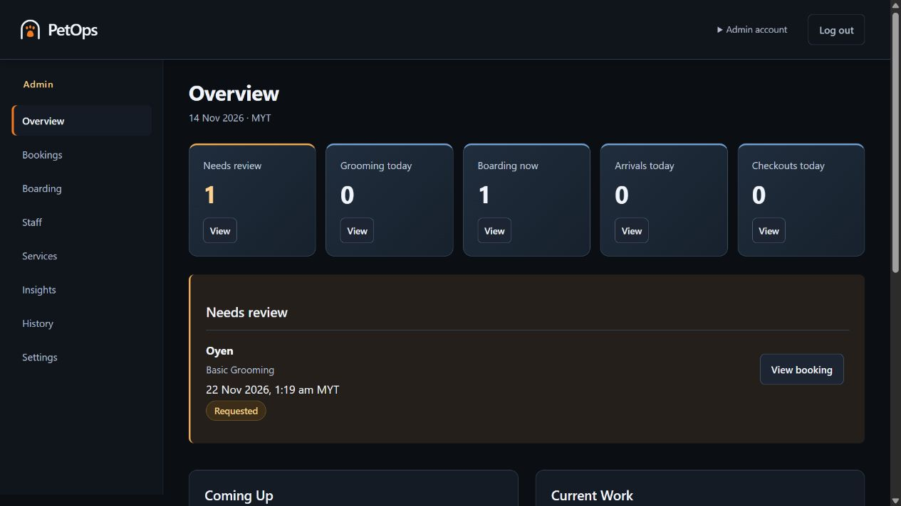
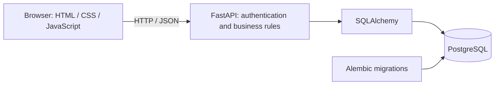

# PetOps

PetOps is a web-based Grooming and Boarding booking and management system developed as an Information Systems Final Year Project. It connects Customer bookings, Staff responsibilities and Admin operations in one application, with a PostgreSQL record of service activity and changes.

| User | Main workflow |
|---|---|
| Customer | Pet → service → availability → request → confirmation or permitted change → history |
| Staff | Assigned work → Grooming fulfilment or Boarding care → completion |
| Admin | Review requests → allocate resources and assign Staff → confirm or reject → manage operations → review history and insights |

**Status:** Core system implementation is complete. Human usability testing is underway. Final regression verification and independent review remain pending before the FYP release is frozen.

[Run locally](docs/developer/SETUP.md) · [Analysis and traceability](docs/analysis/README.md) · [Architecture](docs/architecture/README.md) · [Database](docs/database/README.md) · [Testing evidence](docs/testing/README.md)

## Problem and solution

Manual reservation records, accommodation checks and allocation notes make it difficult to connect a booking to available capacity, the responsible person and its service history. PetOps represents these as linked records with role-specific actions, scheduling checks and recorded status changes. The analysis summary uses no private interview transcripts or case-organisation identifiers.

## Screenshots

Fictional demonstration data from the implemented candidate; these images are not participant results or evidence of real service delivery.

**Customer service selection**

**Admin operational overview**

[View the five-image gallery, including Staff work, Boarding responsibility history and Insights](assets/README.md).

## Key features

- Customer accounts, pet profiles and archiving, service selection, bookings, permitted rescheduling and cancellation.
- Grooming appointments with saved service durations and conflict-checked Staff assignment.
- Boarding capacity and accommodation allocation, Check In, stay notes and Check Out.
- Booking-derived Staff responsibility periods and attributed Boarding handover history.
- Role-scoped notifications, Admin service/Staff configuration, operational overview and period-based insights.

See [workflows and role boundaries](docs/workflows/README.md) for the operating rules.

## Business & Systems Analysis

Project work spans stakeholder-informed requirements, AS-IS/TO-BE process analysis, functional requirements, business rules, role responsibilities, relational data modelling, implementation and verification. The [sanitized analysis and traceability](docs/analysis/README.md) connects these decisions to source modules and test cases.

Examples include preserving a service-duration snapshot when configuration changes, separating physical Boarding capacity from Staff responsibility, and retaining the original responsibility period when a handover takes effect. Private stakeholder evidence and academic correspondence are excluded from this repository.

## Technology

Python · FastAPI · PostgreSQL · SQLAlchemy · Alembic · HTML/CSS/JavaScript · REST-style HTTP APIs · Git. Pytest covers application checks; Node runs the built-in JavaScript harnesses. Dependencies are pinned in [requirements.lock.txt](requirements.lock.txt).

## Security & data integrity

Passwords use salted scrypt hashes. Server-side session authentication, role checks and ownership checks protect API actions. Request validation is backed by PostgreSQL foreign keys, check/exclusion constraints and workflow/history triggers. Booking events and linked fulfilment records preserve supported changes and attribution.

These controls are implemented and tested within the documented scope; they are not a production security certification. See [architecture](docs/architecture/README.md), [database rules](docs/database/README.md) and [known limitations](docs/testing/LIMITATIONS.md).

## Architecture

The [architecture map](docs/architecture/README.md) explains module responsibilities; the [simplified ERD](docs/database/README.md) explains the main relationships.

## Testing

The repository includes functional, authorization/RBAC, data-integrity, concurrency, workflow and JavaScript response-order checks. A recorded targeted PostgreSQL run for this application candidate passed **82 tests with one warning**. This was a selected run, not a final full regression.

Human usability testing is underway; participant outcomes and final acceptance are not claimed here. See the [testing record and safe execution instructions](docs/testing/README.md). Application fixtures clear their selected database and must only run against a separate disposable test database.

## Running locally

Use Python 3.12 and a local PostgreSQL installation with `btree_gist`. Create a virtual environment, install the pinned dependencies, configure a private database URL and apply migrations through `0008` to a new developer database. The [setup guide](docs/developer/SETUP.md) gives the exact steps and startup command.

The [fictional demo guide](demo/README.md) prepares an isolated developer fixture. It never selects a running human-testing environment automatically.

## Demo accounts

**Fictional demonstration credentials only.** These accounts exist after explicitly applying the developer fixture, not on a public service.

| Role | Email | Password |
|---|---|---|
| Customer | `customer.repro@petops.example` | `DemoPass!123` |
| Staff | `staff.repro@petops.example` | `DemoPass!123` |
| Admin | `admin.repro@petops.example` | `DemoPass!123` |

## Scope and licensing

PetOps covers Grooming and Boarding for Customer, Staff and Admin. It does not implement payments, inventory or payroll. This repository is a curated project snapshot with a new, truthful Git history; the original development evidence is retained separately.

No open-source license has been selected. See the [licensing note](LICENSING.md) and [release status](docs/RELEASE.md).
