# PetOps

**A web-based Grooming and Boarding booking and operations management system, built as a Final Year Project case study at Universiti Tenaga Nasional (UNITEN).**

PetOps connects everything a small pet-care business needs to run Grooming appointments and Boarding stays: Customer requests, pet records, Admin review, Staff responsibility, accommodation capacity, day-to-day operations and history. Three roles, **Customer, Staff and Admin**, each get their own view of the same records.

> Academic prototype. It runs locally with fictional data and is not a deployed or commercial service.

[Case study](#the-problem) · [Screenshots](#what-it-looks-like) · [How it works](#how-the-system-works) · [Architecture](#architecture) · [Testing](#testing) · [Run it locally](#run-it-locally) · [Limitations](#scope-and-limitations)

## Key capabilities

| | |
|---|---|
| **Customer booking journey** | Five steps (type, pet, service, date and time, review), with an availability check. The request is confirmed by Admin, not automatically |
| **Admin operations** | A Today view of what needs a decision, a review workspace, a Boarding lodging board of capacity per night, Staff workload and period Insights |
| **Staff work** | Each Staff member sees only the jobs they are responsible for, with one clear next action per job |
| **Boarding capacity** | Accommodation is allocated against a limit on every night of a stay and released at check-out |
| **Responsibility and handover** | Staff accountability is recorded over time, and access follows it, including handover during a stay |
| **History** | Each booking action is recorded as an event with who did it and when; past responsibility periods stay on record |
| **Verified** | 433 automated PostgreSQL tests passed (0 failed); 13 of 13 browser workflows passed; independent technical review closed |

## The problem

The case business took Boarding reservations and checked cage availability by hand, while Customer, pet and stay details lived separately in a basic record application. The information needed to accept a booking, prepare a place and follow the stay was split across manual and digital records. Staff updates were reviewed by the owner, but there was no structured record of who was responsible for each booking.

**Product approach:** one system that carries each booking from request to history:

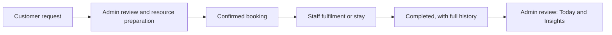

**Key design decisions**

- **Customers see only their own records.** Internal Staff and audit details are not sent to them.
- **Admin prepares resources before confirming.** A Grooming booking needs an eligible groomer; a Boarding booking needs a place on every night.
- **Staff access follows responsibility, not the role alone.** A former Staff member loses access after a handover.
- **The Customer requests dates; Admin chooses the accommodation.** Capacity is checked on the server.
- **History is preserved.** Booking actions are recorded as events with their actor and time, and inactive services or archived pets stay in history.
- **Notifications are in-system only.** There is no email, SMS or WhatsApp.

## What it looks like

All screenshots show the final interface with **fictional data**.

**Customer**

| Book a service: choose the type | Review the request |
|---|---|
| 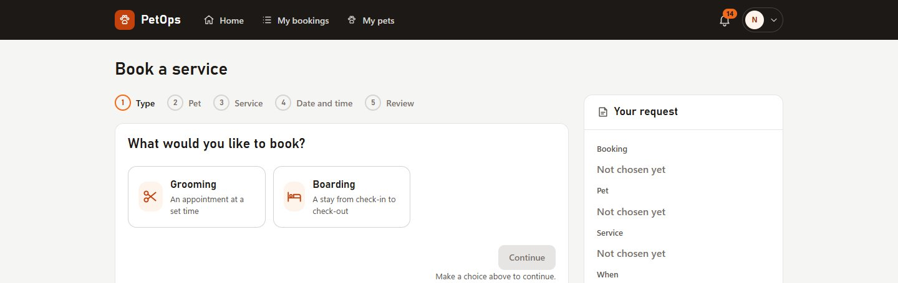 |  |

| Follow the booking: progress, stay updates and activity |
|---|
| 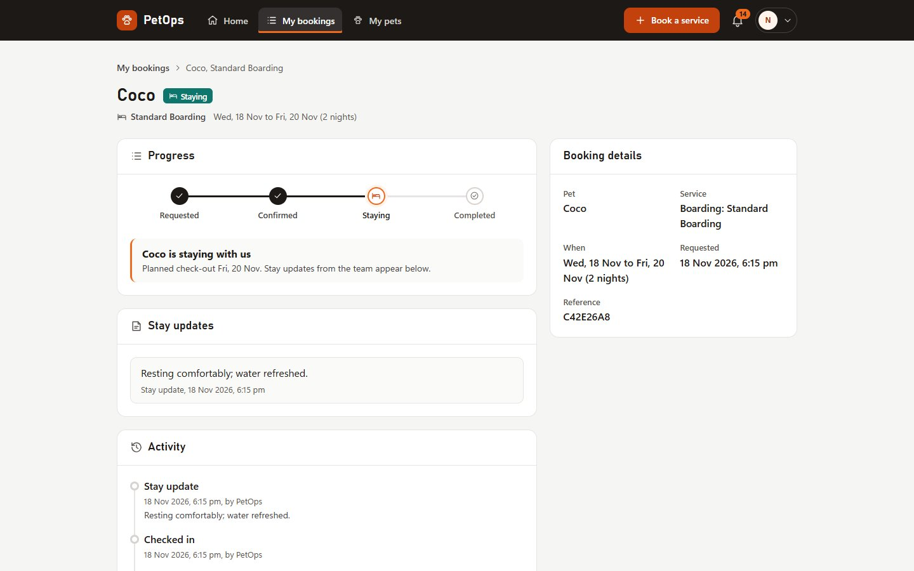 |

**Staff**

| My work: one next action per job | Boarding job: stay progress and responsibility |
|---|---|
| 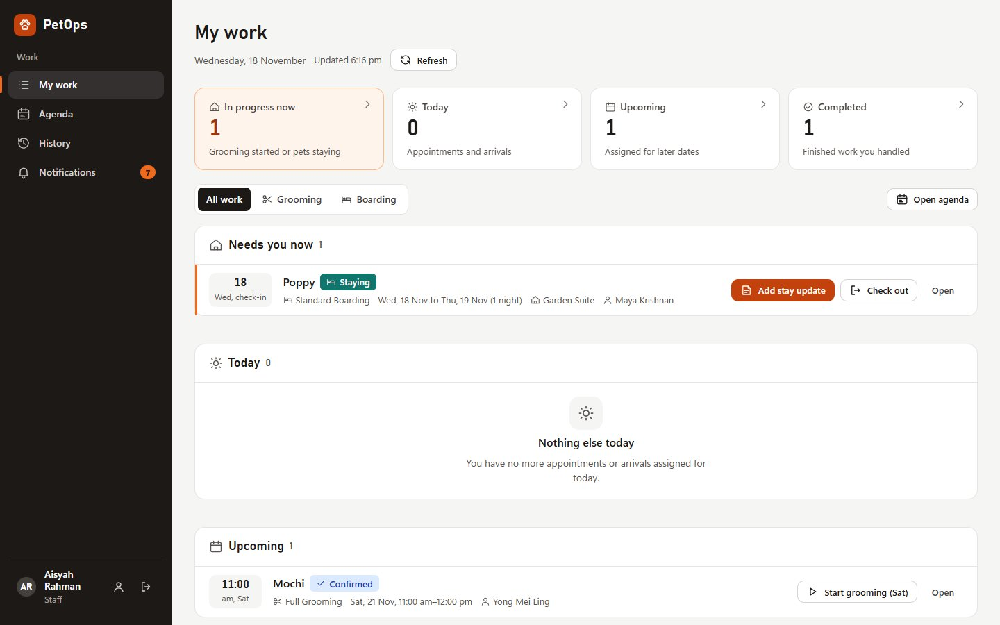 | 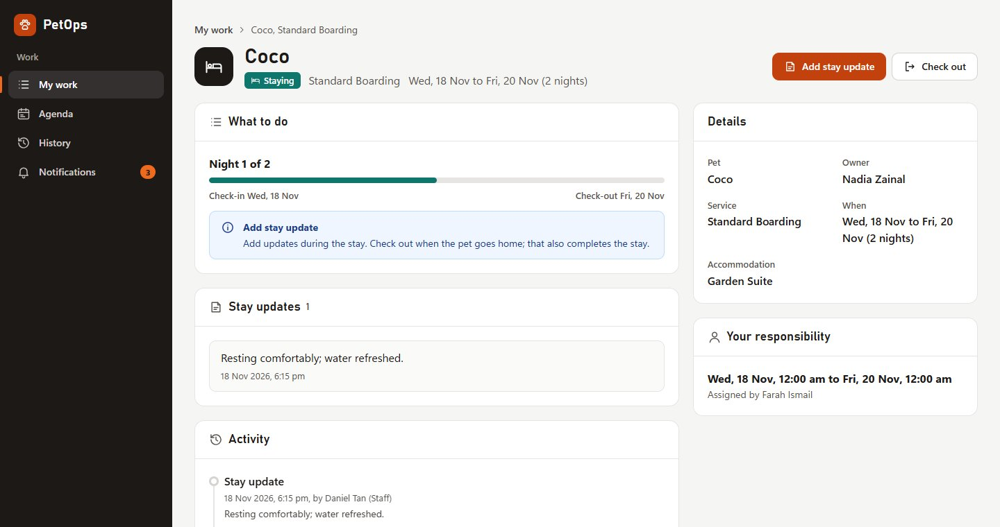 |

**Admin**

| Today: what needs attention | Reviewing a Boarding request |
|---|---|
|  | 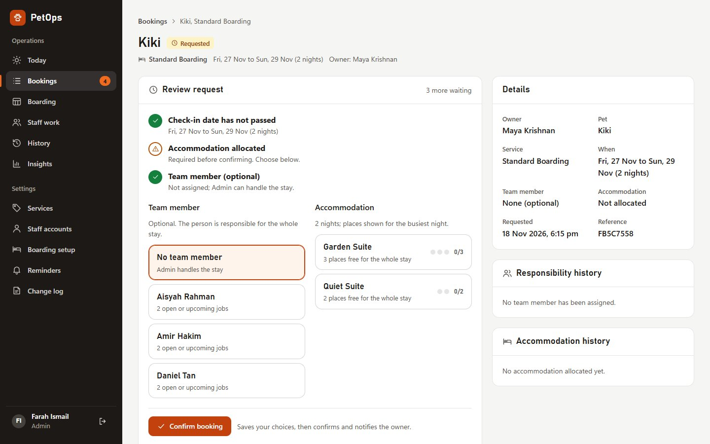 |

| Boarding lodging board: places per unit and night | Insights: a selected period, with drill-down |
|---|---|
|  |  |

## Roles

| Role | What they do | What they cannot do |
|---|---|---|
| **Customer** | Register, manage pets, book Grooming or Boarding, follow progress, change dates or cancel before work starts, read notifications | See anyone else's data; choose the accommodation unit |
| **Staff** | See their own work and agenda; start and complete Grooming; check in, add stay updates, check out | Confirm bookings, allocate resources or change settings; open work no longer assigned to them |
| **Admin** | Review and confirm or reject, assign groomers, allocate accommodation, hand over responsibility, monitor Today and Insights, manage services, Staff accounts, units and reminders | Create bookings for Customers |

## How the system works

**Grooming:** an appointment with one responsible groomer.

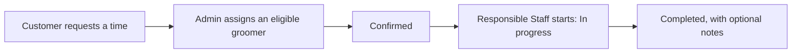

**Boarding:** a stay over several nights, in a unit with limited places.

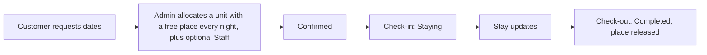

**Changes:** dates can be changed, or a booking cancelled, only while it is Requested or Confirmed. A date change sends the booking back to Requested and releases the groomer or place, so Admin confirms it again. A stay that runs past its planned check-out is labelled *Overdue stay* for visibility only.

Full rules: [workflows](docs/workflows/README.md) · [Insights definitions](docs/analysis/KPI_SEMANTICS.md)

## Architecture

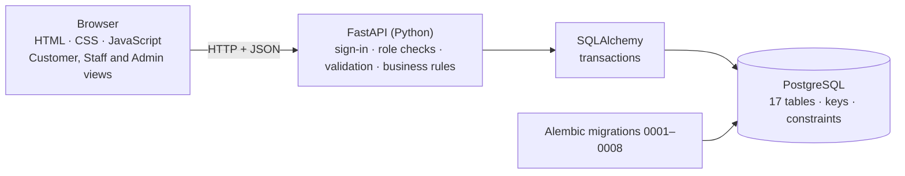

The browser application has no build step; FastAPI serves it and answers its API calls. Every rule is checked on the server, so hiding a button is never the only protection. Writes run in transactions, with row locks and version numbers, so two requests cannot claim the same groomer time or Boarding place. [Architecture and source map](docs/architecture/README.md)

## Data model

PetOps uses a relational PostgreSQL database with **17 application tables**, versioned with Alembic (head `0008`).

- **Hub:** `bookings` connects to the Customer, their pet and the service.
- **Records linked to each booking:** Staff responsibility periods, booking events (history), Grooming records, Boarding allocations and stays, stay notes and notifications.
- **Protection:** foreign keys (`ON DELETE RESTRICT`, except sessions) and database constraints keep these links valid, so a linked record cannot be deleted while others depend on it.

High-level overview and design decisions: [database](docs/database/README.md).

## Access and privacy

- **Sign-in:** passwords are stored as hashes, and sessions are kept on the server and expire.
- **Role checks:** every request is checked against the user's role (Customer, Staff or Admin) on the server.
- **Ownership:** a Customer can reach only their own pets and bookings; other records appear not to exist.
- **Responsibility:** Staff can view a booking while responsible or scheduled, and can act only while currently responsible.
- **Minimal Customer view:** Customers receive only what they need; the Customer timeline shows "You" and "PetOps".

This describes the design and its tests. It is not a security certification.

## Responsive design

PetOps is a **responsive web application**, not a native mobile app: the same pages adapt to the screen width. On phones, the side menu becomes a top bar and bottom tabs, and multi-column layouts stack into one column. This is done with CSS media queries; see the [architecture notes](docs/architecture/README.md#frontend-structure-appstatic).

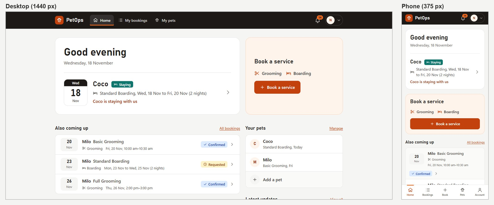

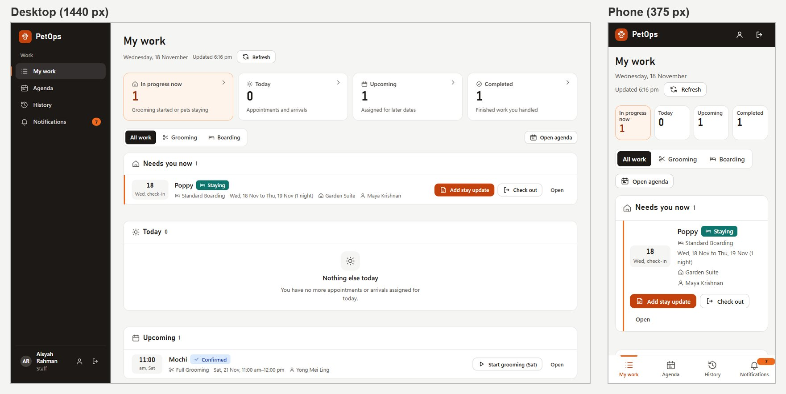

## Testing

| Check | Result |
|---|---|
| Automated regression on PostgreSQL 18 | **433 passed, 0 failed** |
| Browser end-to-end workflows (all three roles) | **13 of 13 passed** |
| Independent technical review of the final build | Passed after one finding was corrected and re-checked |

The tests cover:
- sign-in and sessions;
- role and ownership denials, including direct API calls;
- the Grooming and Boarding lifecycles;
- accommodation capacity, including simultaneous requests;
- responsibility and handover;
- notifications and reminders;
- history;
- Today and Insights counts matching their records.

These are technical verification results, not user testing or production certification. [Testing details](docs/testing/README.md)

## Technology

| Area | Technology |
|---|---|
| Backend | Python, FastAPI, SQLAlchemy, Alembic |
| Database | PostgreSQL |
| Frontend | HTML, CSS, JavaScript (ES modules, no framework) |
| Communication | REST-style HTTP APIs with JSON |
| Verification | pytest, Node.js frontend checks, Playwright browser workflows |
| Version control | Git, GitHub |

## Run it locally

See [local setup](docs/developer/SETUP.md): a Python virtual environment, your own local PostgreSQL databases, private configuration (only placeholders are in `.env.example`), migrations, starting the server, and running the tests. Fictional demo accounts and a short walkthrough are in [demo](demo/README.md).

## Scope and limitations

**Limitations**
- **Environment:** academic prototype, run locally with fictional data. It is not deployed or security-certified.
- **Not evaluated or certified:** the final interface was not formally evaluated with users, and there is no formal accessibility or cross-browser certification. Earlier user feedback shaped its design.
- **Notifications:** in-system only.
- **Not supported:** active Grooming handover, moving an occupied Boarding unit, opening hours or suggested time slots, past-occupancy reports, and Staff leave or attendance.

Full list: [limitations](docs/testing/LIMITATIONS.md).

**Out of scope:** payment/POS, commission, inventory, payroll, WhatsApp/SMS, a native mobile app, multi-branch, multi-tenant SaaS, an AI chatbot and commercialisation features.

## What this project demonstrates

Working through PetOps involved:

- **Requirements analysis:** interviewing the business, mapping the current (AS-IS) process and designing the new (TO-BE) one.
- **Role and permission modelling** for three roles, with ownership and responsibility rules.
- **Business-rule definition:** when a booking can be confirmed, changed or cancelled, and how capacity and handover work.
- **Workflow and data modelling:** swimlanes, sequence and status diagrams, and a 17-table relational schema with integrity constraints.
- **API-based system thinking:** a browser frontend, a JSON API and server-side validation.
- **Testing and traceability:** linking rules to automated tests, and checking access boundaries as well as normal paths.
- **Scope control:** deciding what not to build, and documenting limitations honestly.

AI tools assisted the implementation, debugging and documentation. I reviewed and tested the work, and I can explain its design decisions. This is an academic project, not professional or production experience.

## Academic context

Final Year Project 1, Bachelor in Information Systems (Business Analytics), UNITEN, 2026. The case study was RS Pet House. Interview material, the academic report and the internal review records are private and not included here. [Release identity](docs/RELEASE.md) maps this public repository to the frozen build that was tested.

## License

[MIT](LICENSE), copyright (c) 2026 Ahmad Sahil Nair. Third-party dependencies keep their own licences. See [licensing scope](LICENSING.md).
