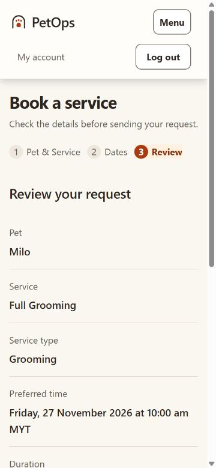
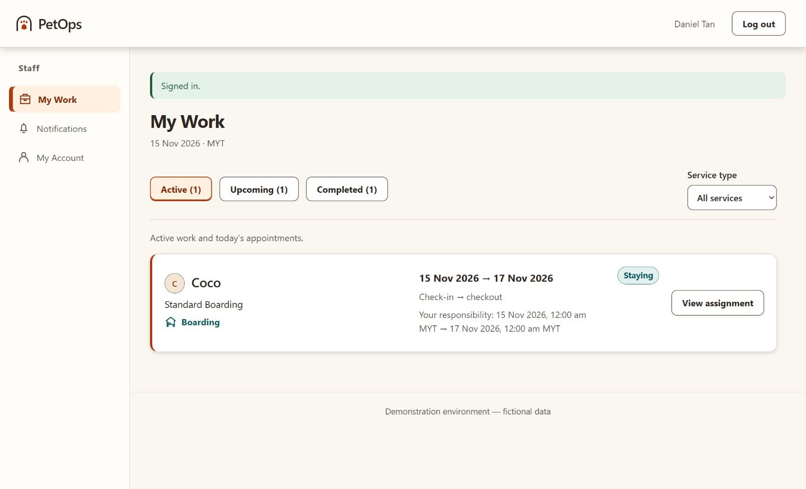
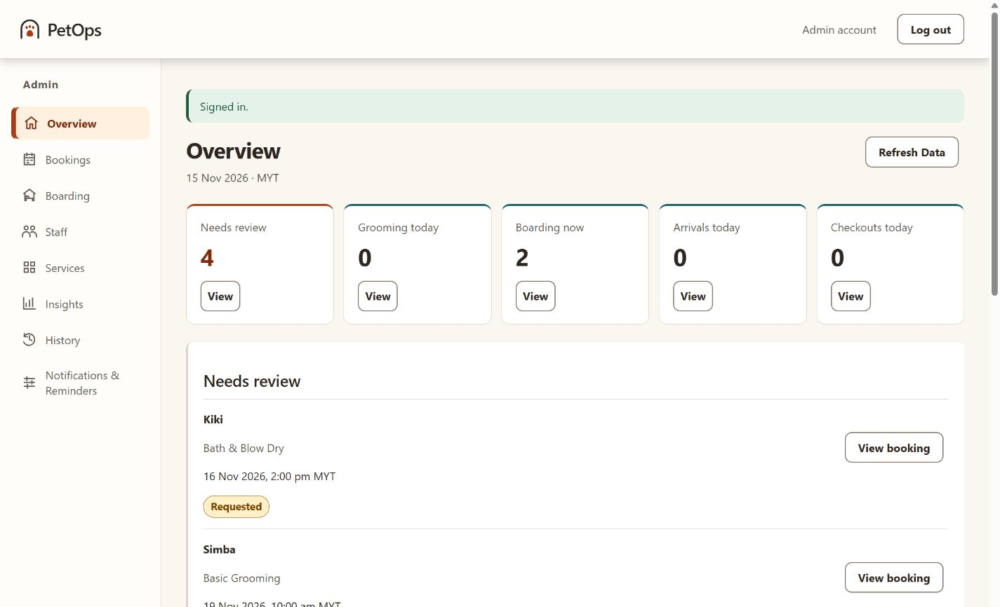
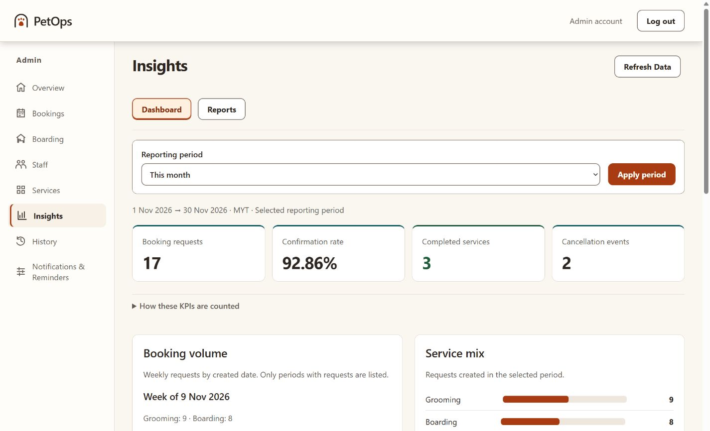
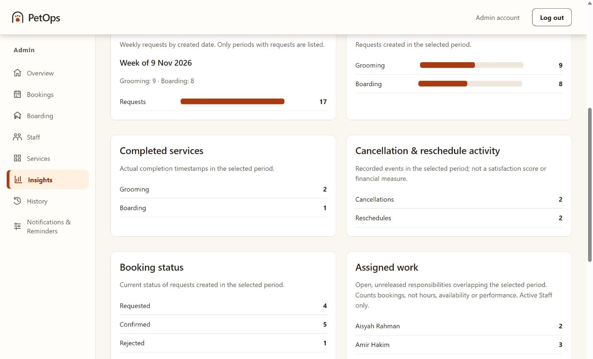
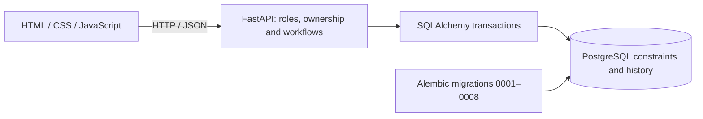

# PetOps

PetOps is a web-based pet grooming and boarding management system developed as my Final Year Project. It supports **Customer, Staff and Admin** workflows, from pet profiles and booking requests to staff responsibility, service operations, history and operational insights.

The project connects booking, accommodation and service records so users can see what needs attention, who is responsible and what happened. It builds on documented Boarding processes that combined manual reservation/capacity checks with digital records and allocation notes.

[Project Walkthrough](demo/README.md) · [Local Setup](docs/developer/SETUP.md) · [Analysis](docs/analysis/README.md) · [Architecture](docs/architecture/README.md) · [Database](docs/database/README.md) · [Testing](docs/testing/README.md)

## Quick highlights

- **Three role-specific workspaces:** Customer, Staff and Admin.
- **Grooming and Boarding bookings:** resource preparation, service operations and retained history.
- **PostgreSQL relational database:** ownership links, capacity/conflict checks and data-integrity controls.
- **Authentication and role-based access:** server-enforced permissions and record ownership.
- **Operational Insights:** booking activity, service completion, physical occupancy and assigned work.
- **394 automated regression cases passed** in the recorded final run.

## See the system

Six existing screenshots show the interface using **fictional demonstration data**. Counts and dates reflect capture time, not business outcomes or usability measurements.

<table>
<tr>
<td width="50%" align="center">
 
<strong>Customer Home</strong> 
Find the main booking action and navigate personal records.
</td>
<td width="50%" align="center">
 
<strong>Booking review</strong> 
Review the selected pet, service and appointment before submitting.
</td>
</tr>
<tr>
<td width="50%" align="center">
 
<strong>Staff workspace</strong> 
Inspect assigned responsibility and access the relevant service work.
</td>
<td width="50%" align="center">
 
<strong>Admin Overview</strong> 
See the operational queue and requests needing review.
</td>
</tr>
<tr>
<td width="50%" align="center">
 
<strong>Operational Insights</strong> 
Review booking and service summaries for an explicit reporting period.
</td>
<td width="50%" align="center">
 
<strong>Status and assigned work</strong> 
Distinguish booking status from staff responsibility measures.
</td>
</tr>
</table>

[View the full-size gallery and capture notes](assets/README.md).

## What I worked on

My project work covered the path from analysing a business problem to implementing and evaluating a working system:

- **Business and systems analysis:** documented the existing process, mapped AS-IS/TO-BE workflows, and translated operational needs into requirements and business rules.
- **Database and backend:** relational modelling, PostgreSQL integrity controls, FastAPI/SQLAlchemy APIs and Alembic migrations.
- **Access and workflow design:** authentication, role/ownership checks, booking validation, resource conflicts, responsibility handover and retained history.
- **User interface and reporting:** Customer, Staff and Admin pages, clearer navigation/forms, and operational Insights with explicit metric definitions.
- **Verification and evaluation:** requirements-to-test traceability, automated regression work and bounded qualitative usability evaluation.

AI tools assisted implementation, debugging and documentation. These contributions describe the project work I undertook, without claiming every line was manually authored or professional production experience. Review the [analysis and traceability examples](docs/analysis/README.md) alongside the linked implementation and tests.

## Technology stack

| Area | Technologies |
|---|---|
| Backend | Python, FastAPI, SQLAlchemy |
| Database and migrations | PostgreSQL, Alembic |
| Interface | HTML, CSS, JavaScript |
| Testing | Pytest, built-in-only Node.js test harnesses |
| Version control | Git, GitHub |

[Locked Python dependencies](requirements.lock.txt) are included. The interface does not require a frontend package build.

## Main workflows

| Role | Typical journey |
|---|---|
| **Customer** | Manage own profile/pets → select a service → request a booking → follow status or make permitted changes → view history |
| **Admin** | Review requests → prepare capacity/resources → assign eligible Staff → confirm → monitor operations → review Insights/history |
| **Staff** | Inspect assigned responsibility → perform authorized Grooming/Boarding actions → record care or service progress → complete permitted work |

**Grooming:** request → Staff assignment → confirmation → start → complete.

**Boarding:** request → accommodation allocation and optional Staff responsibility → confirmation → Check In → Staying → Check Out → Completed.

Staff eligibility uses active status and conflicting PetOps responsibilities. Boarding supports attributed responsibility handover during a stay; physical accommodation allocation is a separate concern. Pre-work rescheduling requires resource preparation and reconfirmation. See the [workflow guide](docs/workflows/README.md) for the exact role and state boundaries.

## Architecture and database

One FastAPI application serves the browser interface and JSON APIs. Server-side authorization and workflow checks work with relational constraints and transactions.

The database links Customers, pets, bookings, service records, accommodation allocations, staff responsibilities and events. Saved service durations and original/effective responsibility periods preserve the meaning of earlier records when configuration or responsibility changes.

- [Architecture and source map](docs/architecture/README.md)
- [Database diagram and design decisions](docs/database/README.md)
- [Insights and KPI definitions](docs/analysis/KPI_SEMANTICS.md)

## Testing and quality

The final recorded **PostgreSQL-backed regression suite collected and ran 394 cases: 394 passed, 0 failed, 0 errors, 0 skipped, exit code 0**. The total includes offline tooling/frontend cases; it does not mean 394 database-only tests. This README update did not rerun that suite.

An independent project review returned **PASS WITH CONDITIONS**, with no blocking implementation defect or current MUST requirement gap. The documented provenance and claim conditions were subsequently verified. The [testing record](docs/testing/README.md) explains the review boundaries, the two corrected obsolete test setups and the passing targeted/full reruns.

Human usability evaluation is **qualitative**. It supports bounded observations about the interface, not numerical improvement, satisfaction percentages or general-market usability claims.

This academic FYP system has not been certified for production readiness/security, fresh-machine deployment or full accessibility/cross-browser/zoom support. See [known limitations](docs/testing/LIMITATIONS.md) and [version provenance](docs/RELEASE.md) for details. Raw private academic, participant and audit evidence is excluded.

## Walkthrough and local setup

**This repository contains source and documentation, not a hosted PetOps application.**

- [3–5 Minute Walkthrough Guide](demo/README.md): a suggested route through the roles using fictional local demonstration records.
- [Local Setup](docs/developer/SETUP.md): dependencies, your own new PostgreSQL databases, private environment configuration, migrations, startup and test execution.

The local guide includes guarded fictional demo setup/reset instructions. Use separate development and test databases, and read the reset/test warnings before running commands.

## License

Project code, documentation and included project assets are available under the [MIT License](LICENSE), copyright (c) 2026 Ahmad Sahil Nair. Third-party dependencies retain their respective licenses. Private academic/UAT/audit material is not part of this repository. See [licensing scope](LICENSING.md).

