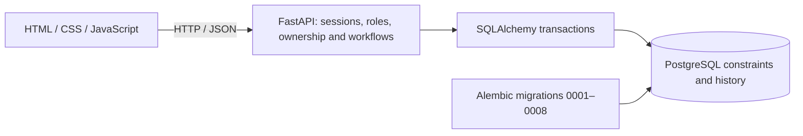

# PetOps

An **Information Systems / Business & Systems Analysis** Final Year Project supported by a working Grooming and Boarding booking-management system, relational database design, access controls, validation and operational reporting.

**Status:** technical baseline frozen for FYP closure. Final PostgreSQL-backed regression: **394/394 passed**. Independent C03 audit: **PASS WITH CONDITIONS**, with no blocking implementation defect or current MUST gap; subsequent control verification satisfied the freeze conditions. Human usability evidence is qualitative. This is an academic project, not production/security/accessibility certification.

[3–5 minute demo](demo/README.md) · [Local setup](docs/developer/SETUP.md) · [Analysis](docs/analysis/README.md) · [Database](docs/database/README.md) · [Verification](docs/testing/README.md)

## Business problem and solution

The documented existing Boarding process combined manual reservation/capacity checks with digital records and general allocation remarks. PetOps connects structured requests, resources, responsibility and service history. This is a bounded process improvement, not a claim the organisation previously had no software or that all operations are automated. Private organisation and stakeholder material is excluded.

## Roles and core workflows

| Role | Responsibilities |
|---|---|
| Customer | Manage own profile/pets, request a service, follow own bookings, permitted changes and history |
| Staff | Inspect assigned work, perform authorized Grooming/Boarding actions and record care |
| Admin | Prepare resources, confirm/reject, manage active operations/catalogue/Staff and review history/Insights |

Grooming: request → Staff assignment → confirmation → start → complete. Boarding: request → accommodation allocation, optional Staff → confirmation → Check In → Staying → Check Out → Completed. Pre-work rescheduling requires resource preparation/reconfirmation. [Role and workflow boundaries](docs/workflows/README.md).

## Key features

- Owned pet profiles/archive and service requests with validation.
- Duration-aware Grooming assignments; Boarding capacity and physical occupancy checks.
- Booking-derived Staff responsibility, conflict prevention and attributed mid-stay handover history.
- Role-scoped notifications, retained events, service/Staff configuration and operational Insights.

## Business and system analysis

[AS-IS/TO-BE and sample traceability](docs/analysis/README.md) connect requirements, business rules, role responsibilities, design decisions, implementation and actual tests. Examples include duration snapshots, separating physical allocation from responsibility, and preserving the original plan across handover. The portfolio summarizes analysis without exposing private interview transcripts or claiming new stakeholder validation.

## Technology stack

Python · FastAPI · PostgreSQL · SQLAlchemy · Alembic · HTML · CSS · JavaScript · REST-style HTTP/JSON · Git/GitHub. Pytest and built-in-only Node harnesses support testing. [Pinned dependencies](requirements.lock.txt); no frontend package build is required.

## Architecture and database

[Architecture map](docs/architecture/README.md) · [Simplified ERD and database decisions](docs/database/README.md). `StaffResponsibility` preserves planned periods and attribution; it does not represent attendance or leave. KPI creation cohorts, decision events, completions and current occupancy use distinct time bases. [Insights definitions](docs/analysis/KPI_SEMANTICS.md).

## Security and ownership

Salted scrypt password hashes, server-side session records, server-enforced roles/ownership, strict input validation and PostgreSQL constraints/triggers protect the approved workflows. Hiding a button is insufficient authorization. These implemented controls do not establish production security or least-privilege deployment certification.

## Testing and verification

The final suite collected and ran **394 cases: 394 passed, 0 failed/errors/skipped, exit 0**, with one retained dependency warning, in 898.40 seconds. The initial full run had two obsolete test-setup failures; correction of those setups preserved denial/history assertions, passed an 8-case retest, then the same full suite passed. **No product source changed in that correction cycle.** The total includes offline tooling/frontend cases; it is not 394 distinct database-only tests.

C03 independently reviewed the source/evidence, confirmed the test-setup diagnosis and returned **PASS WITH CONDITIONS**. C03 did not independently rerun the full PostgreSQL suite. Its provenance/claim conditions were subsequently verified, followed by the controller's technical freeze. [Sanitized verification record and safe commands](docs/testing/README.md). Raw academic audit material remains private.

## User evaluation

Case-organisation staff and friends/family participated in qualitative evaluation. Reported observations indicated clearer Customer navigation/booking, Staff workflow and Admin information after refinement. No percentages, measured timing improvement, satisfaction scores or general-market usability are claimed. Exploring Staff/Admin interfaces does not confer professional role expertise.

## Screenshots

Original captures using fictional demonstration records, not real customers or participant results.

[Six-screen role gallery](assets/README.md).

## Demo and local setup

Use your own new local PostgreSQL databases; never reuse a retained UAT/demo database. [Setup](docs/developer/SETUP.md) covers dependencies, private environment configuration, migrations, startup and tests. The [demo guide](demo/README.md) supplies fictional accounts, a short walkthrough and guarded reset/troubleshooting. Fresh-machine installation has not been certified. No public service is deployed by this repository.

## Limitations

No production readiness/security, fresh-machine deployment, comprehensive accessibility/cross-browser/zoom or recovery certification. External Staff leave/absence is not a current implemented MUST; occupied-unit transfer is outside scope; generic exceptional active-state override remains undefined. Edit preflight is not a universal atomic concurrent-edit protocol. No payments, payroll, inventory or commercial multi-tenant platform. [Detailed limitations](docs/testing/LIMITATIONS.md).

## AI-assisted development and academic context

AI tools assisted implementation, debugging and documentation. This repository does not claim every line was manually authored or that its owner has senior engineering experience. Project discussion should focus on substantiated requirements/design decisions, validation, testing and the ability to explain the system; the presence of an artifact does not prove personal mastery. This is an academic FYP portfolio, not the full assessed workspace or private research archive.

## Licensing and release

Project code and documentation are available under the [MIT License](LICENSE), copyright (c) 2026 Ahmad Sahil Nair. Third-party dependencies retain their respective licenses. Private academic/UAT/audit material is excluded. See [licensing scope](LICENSING.md) and [version boundaries](docs/RELEASE.md). GitHub visibility remains a separate owner decision.
