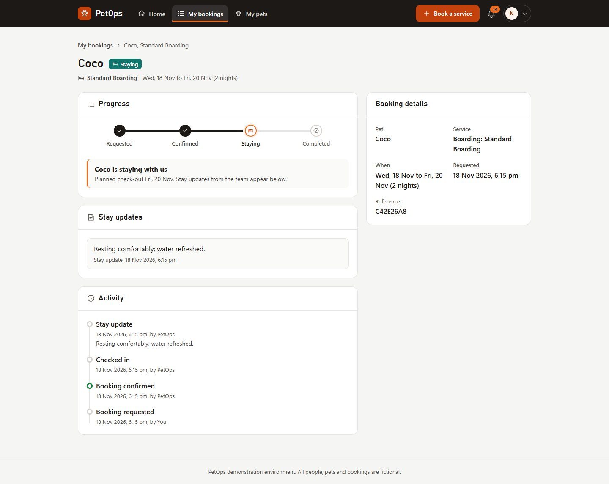
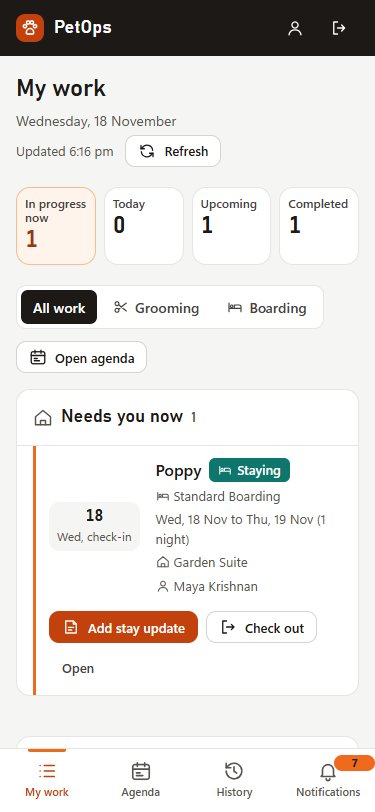
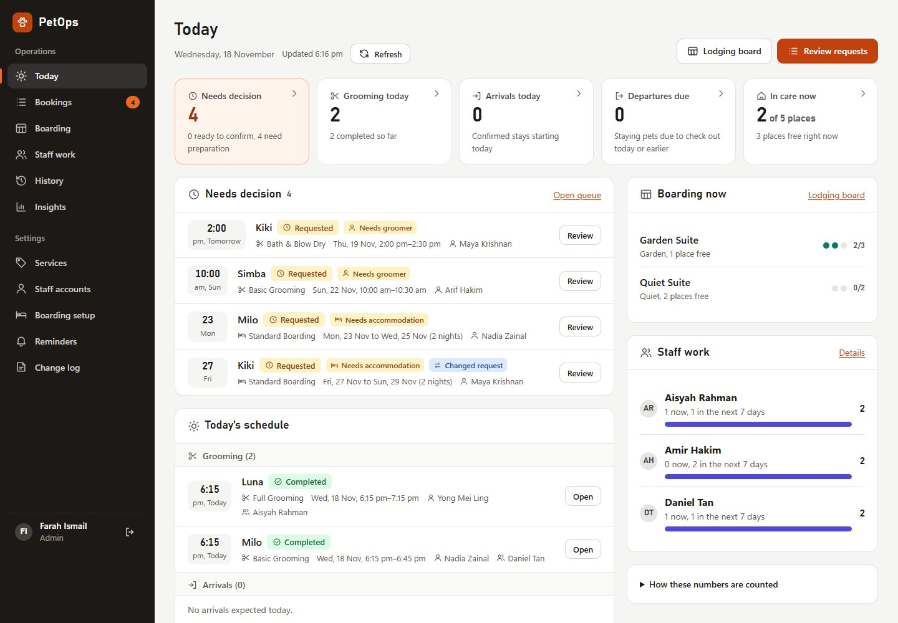
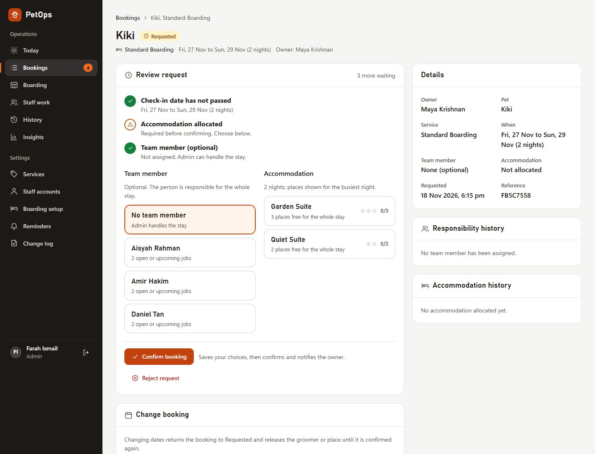

# Interface gallery (final frozen build)

Ten captures of the final 18 November 2026 interface, using **fictional demonstration data**.

- **Source:** the existing frozen-build screenshot set, cropped only (no retouching). No interface was changed to produce them.
- **Content:** counts and dates reflect the moment of capture; they are not business results or usability measurements.
- **Privacy:** no login credentials, real people, real business data or browser chrome appear.

## Customer

## Staff

## Admin

The tall pages (Today, review, Insights, booking page) show their upper part only.
