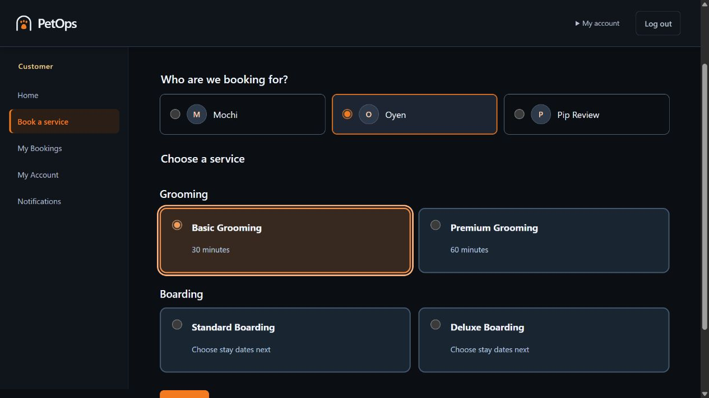
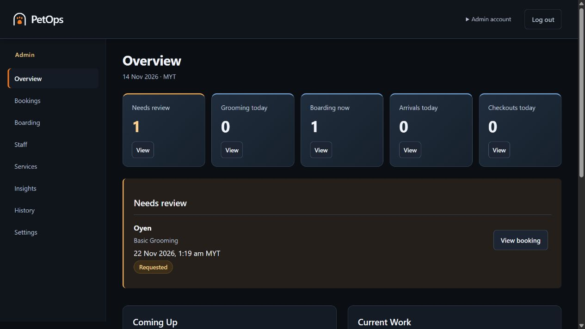
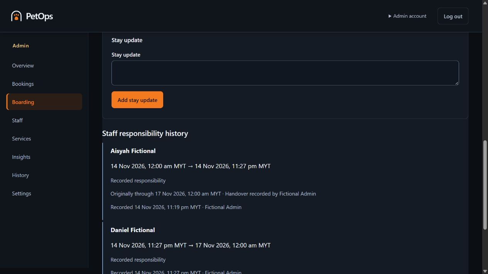
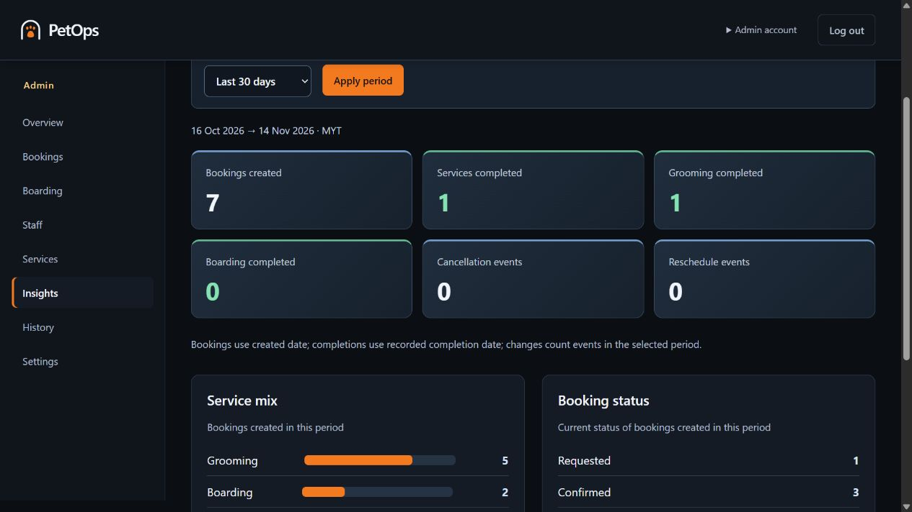

# Interface gallery

Five images were selected from the existing 0008 candidate walkthrough. They show fictional demonstration accounts and records, not participants or real service delivery. The original pixels are retained; none was generated or retouched for this repository. Dates, counts and example records reflect capture time.

The gallery is proposed for the private repository. Student confirmation of sharing rights and the intended presentation is still required before hosting. Visual inspection found no visible private contact details, browser profile chrome or local machine paths; that is a bounded review, not an absolute privacy guarantee.

## Customer booking

## Admin Overview

## Staff My Work on mobile

This is a narrow mobile capture. A later approved desktop capture would communicate Staff queue detail more clearly; no new capture or runtime changes were made for repository preparation.

## Boarding responsibility history

## Insights

