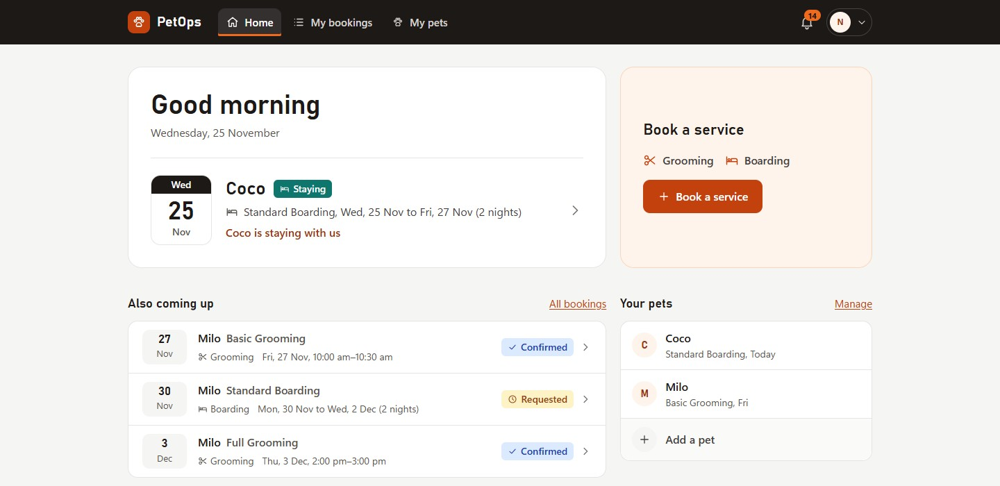
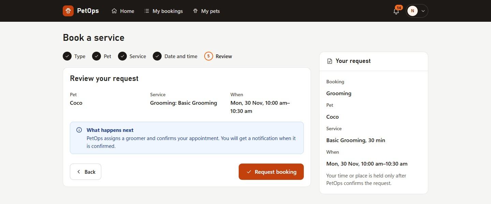
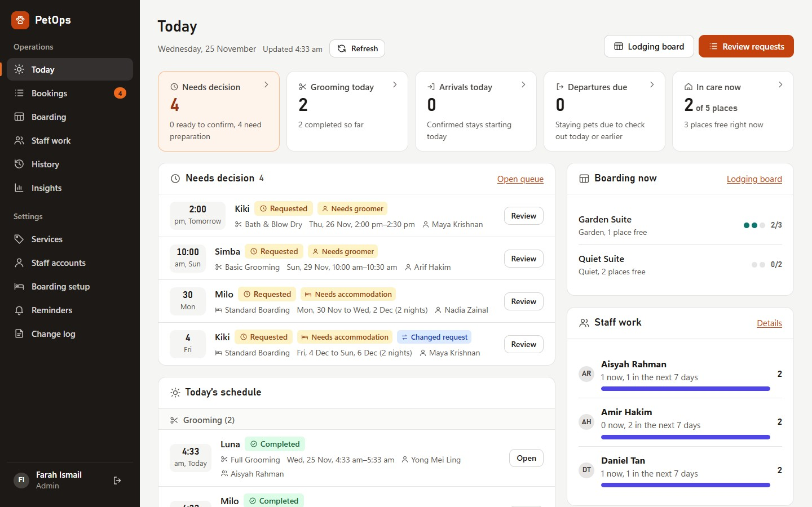
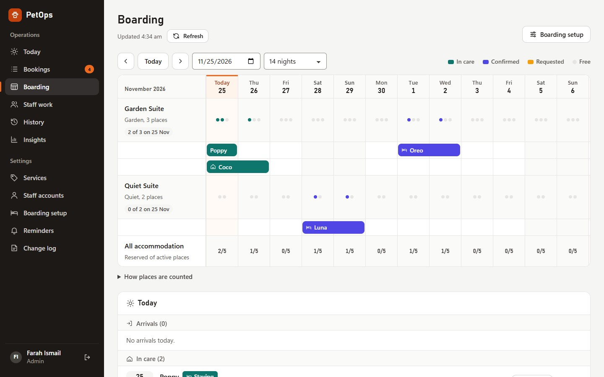
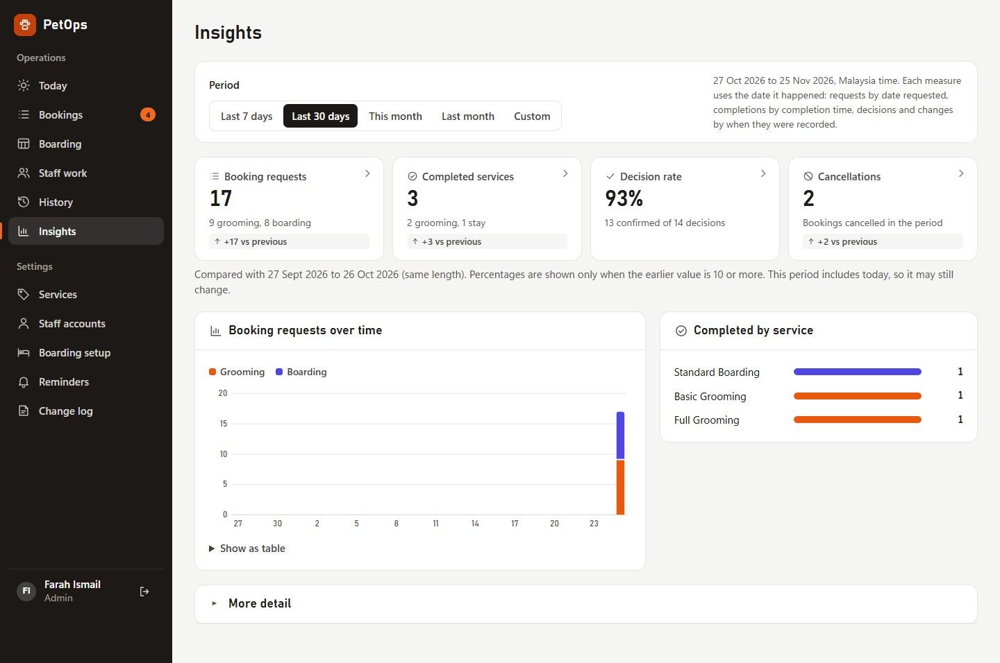

# Interface gallery (corrected frozen build)

Ten desktop captures and two desktop-and-phone comparisons of the corrected 25 November 2026 interface, using **fictional demonstration data**.

- **Source:** the corrected-build screenshot set (1440 px desktop, 375 px phone), cropped and placed side by side only (no retouching). No interface was changed to produce them.
- **Content:** counts, dates and times reflect the moment the fictional data was prepared and captured. They are not business results or usability measurements.
- **Privacy:** no login credentials, real people, real business data or browser chrome appear.

## Customer

## Staff

## Admin

## Responsive layout (1440 px desktop and 375 px phone)

Tall pages show their upper part only (Insights is shown in full).
