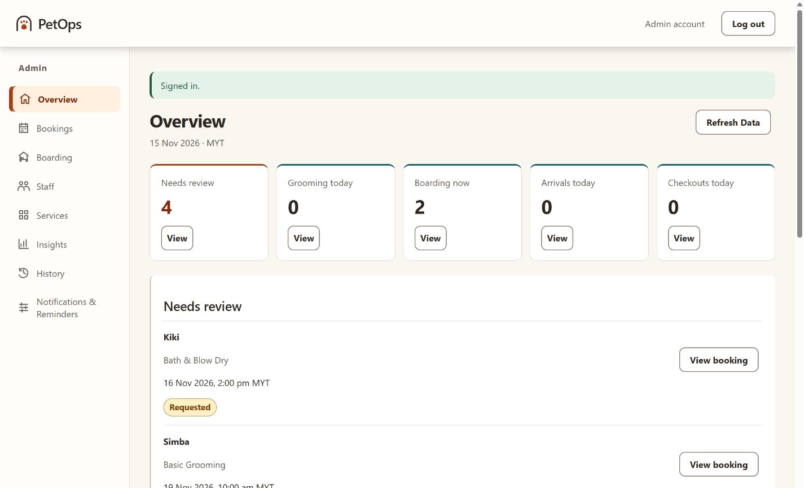
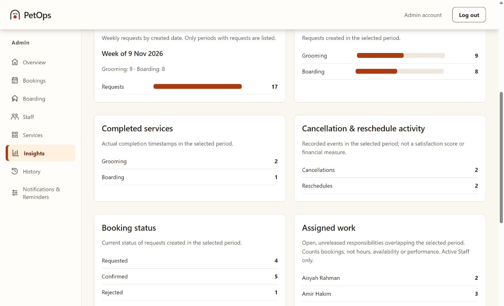

# Interface gallery

Six original, unretouched captures from the final application candidate e174d81, using fictional demo records. No new runtime capture or participant session is claimed. The Customer/Staff presentation was preserved; final core Insights captures include the r3 status restoration. Counts/dates reflect capture time, not business results or measured usability. Some auxiliary captures preceded the final fixture rebuild; they illustrate their named screens rather than a synchronized database snapshot.

## Customer navigation

## Customer booking review

## Staff assigned work

## Admin operational queue

## Admin Insights

## Status and responsibility measures

Visible identities and records are fictional. These images contain no login credentials, participant forms, real business data or browser profile chrome. Their source/privacy review is bounded, not a guarantee about all possible metadata. Customer history and detailed Boarding handover can be inspected in the local demo; no missing screenshot was fabricated.
