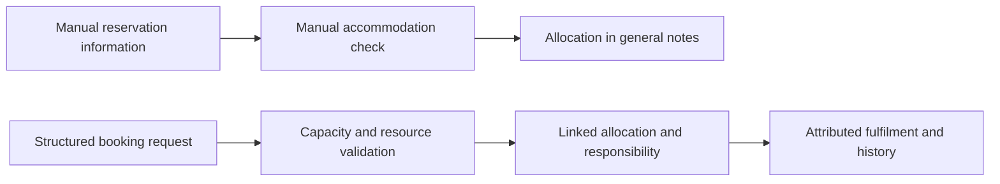

# Business and systems analysis

This sanitized project summary connects operational needs to implemented rules and tests. The underlying FYP requirements/report materials record stakeholder-informed findings and AS-IS/TO-BE analysis. Private interview evidence, participant identities, consent records and correspondence remain outside this repository; the case business is named only as the FYP case study. The summary does not reproduce a confidential transcript or claim new stakeholder validation.

## From the existing process to the system

The documented Boarding process used manual/handwritten reservation information, manual accommodation availability checks and allocation information in general remarks. PetOps separates these into booking, accommodation, allocation, responsibility and service-history records.

The first row summarizes the documented AS-IS Boarding findings. The second describes the implemented TO-BE; it is not a claim that every manual business process has been automated.

## Decisions a reviewer can inspect

| Need / rule | Design and implementation | Test evidence to inspect |
|---|---|---|
| Separate access for Customer, Staff and Admin | Session/role checks in [security.py](../../app/security.py); owner-scoped APIs | `test_role_matrix_denials_do_not_mutate` in [test_hardening.py](../../tests/test_hardening.py) |
| A Customer can book only their own pet | Composite ownership foreign key in [models.py](../../app/models.py) | `test_all_cross_customer_record_paths_are_isolated` in [test_hardening.py](../../tests/test_hardening.py) |
| A service edit must not change an existing appointment's duration | Duration snapshot and [availability rules](../../app/availability.py) | `test_duration_snapshot_and_future_configuration` in [test_slice2.py](../../tests/test_slice2.py) |
| Active, non-conflicting Staff can be assigned without a generic availability record | [Responsibilities](../../app/responsibilities.py) and [0008 rules](../../alembic/versions/0008_rules.sql) | `test_active_staff_needs_no_generic_window` in [test_product_simplification.py](../../tests/test_product_simplification.py) |
| Boarding cannot exceed available accommodation capacity | Allocation/capacity checks and [Boarding routes](../../app/boarding_routes.py) | `test_physical_checkin_race_has_only_one_remaining_place` in [test_slice4.py](../../tests/test_slice4.py) |
| A handover must preserve previous responsibility | Original/effective periods and attributed events | `test_mid_stay_handover_preserves_history_and_access` in [test_product_simplification.py](../../tests/test_product_simplification.py) |
| A profile/pet change must not expose another owner's data or erase history | Scoped account APIs and pet archiving | `test_pet_archive_keeps_history_and_ownership` and `test_account_fields_remain_scoped` in [test_product_simplification.py](../../tests/test_product_simplification.py) |
| Operational changes need consistent history | Transactional events and PostgreSQL triggers | `test_integrated_customer_to_completion_notifications_and_admin_review` in [test_final_hardening.py](../../tests/test_final_hardening.py) |
| Customers must not receive internal Staff or audit data | Reduced Customer projection in [projections.py](../../app/projections.py) | `test_customer_responses_carry_no_internal_staffing_or_audit_data` in [test_revamp_2026_11_18.py](../../tests/test_revamp_2026_11_18.py) |
| Former Staff lose access after reassignment or handover, on every route | `staff_scope` in [responsibilities.py](../../app/responsibilities.py) | `test_former_staff_loses_detail_timeline_and_notification_context` in [test_revamp_2026_11_18.py](../../tests/test_revamp_2026_11_18.py); [test_c03_m01_legacy_staff_scope.py](../../tests/test_c03_m01_legacy_staff_scope.py) |
| A dashboard count must equal its list | One server definition per count in [operations.py](../../app/operations.py) and [dashboard.py](../../app/dashboard.py) | `test_insights_counts_equal_records_and_trend_is_zero_filled` in [test_revamp_2026_11_18.py](../../tests/test_revamp_2026_11_18.py) |

This is a portfolio traceability sample, not a replacement for the full approved FYP requirements matrix. All cited tests are part of the final 433-test regression. The [testing record](../testing/README.md) separates execution results from test presence and independent review.

The project work covered analysis, workflow and role design, relational modelling, API and interface implementation, and verification. This repository presents those artifacts and decisions for technical review.

Earlier human feedback was qualitative and was given on a previous version of the interface. It provides no numerical improvement or general-market validation, and the final redesigned interface has not been evaluated with users.
