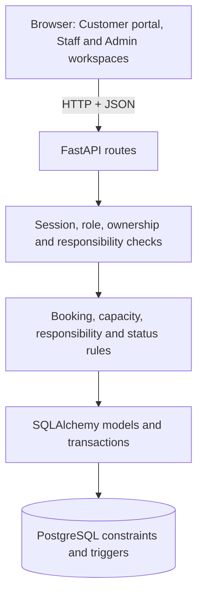

# Architecture

One FastAPI application serves both the browser interface and the role-scoped JSON API. SQLAlchemy maps the relational records, and Alembic maintains the PostgreSQL schema. The interface is plain HTML, CSS and JavaScript ES modules: there is no frontend framework and no build step.

## Backend source map

| Responsibility | Source |
|---|---|
| App entry, sign-in/logout, Customer API, page shell and caching | [main.py](../../app/main.py), [templates/index.html](../../app/templates/index.html) |
| Password hashing, sessions, `require_roles` | [security.py](../../app/security.py) |
| Request validation | [schemas.py](../../app/schemas.py) |
| Booking transitions, events, reschedule and cancel | [services.py](../../app/services.py) |
| Staff eligibility, Grooming time and Boarding capacity checks | [availability.py](../../app/availability.py), [resource_routes.py](../../app/resource_routes.py) |
| Responsibility periods, handover, Staff read scope (`staff_scope`) | [responsibilities.py](../../app/responsibilities.py) |
| Grooming and Boarding operations | [grooming_routes.py](../../app/grooming_routes.py), [boarding_routes.py](../../app/boarding_routes.py) |
| Customer data minimisation | [projections.py](../../app/projections.py) |
| Role-filtered booking timeline | [timeline.py](../../app/timeline.py) |
| Admin Today, lodging board, overdue-stay rule | [operations.py](../../app/operations.py) |
| Insights periods, trends and drill-down records | [dashboard.py](../../app/dashboard.py) |
| Notifications and reminders | [notifications.py](../../app/notifications.py) |
| Admin accounts, services and change log | [management.py](../../app/management.py) |
| Models and migrations | [models.py](../../app/models.py), [alembic/versions](../../alembic/versions) |

## Frontend structure (`app/static`)

| Folder | Contents |
|---|---|
| `js/core/` | DOM builder, router and **role policy** (`routes.js`: the menu each role sees), API client, session handling, formatting in Malaysia time, labels, shell, overlays |
| `js/customer/`, `js/staff/`, `js/admin/` | Each role's pages (for example `customer/book.js`, `staff/work.js`, `admin/today.js`, `admin/boarding.js`, `admin/insights.js`) |
| `js/shared/` | Notifications, account, sign-in |
| `css/` | `tokens.css` (colours, spacing, type), `base.css`, `layout.css`, `components.css`, `pages.css` |

The menu in `routes.js` is presentation only. Every page loads its data from server endpoints that check the role again. Hiding a button grants or removes nothing.

**Responsive design** uses CSS media queries, with no separate mobile app:

- **Below 1280 px:** the Staff and Admin sidebar becomes an icon rail (`layout.css`).
- **Below 768 px:**
  - the sidebar is replaced by a top app bar plus a fixed bottom tab bar (`.tabbar`);
  - multi-column grids collapse to one column;
  - panels and dialogs adapt (`components.css`).
- **Page layouts** in `pages.css` reflow at about 1000 px, 640 px and 520 px; examples are the Customer Home hero and the booking wizard.
- **Reduced motion:** honoured through `prefers-reduced-motion`.

## Integrity and concurrency

- **Writes:** each change runs in a database transaction. Row locks (`with_for_update`) and version columns stop two requests from claiming the same Staff time or accommodation place.
- **Database rules:** PostgreSQL constraints and triggers (migrations 0002–0008 with their `.sql` rule files) reject inconsistent writes even if an API check were bypassed. They also protect history from deletion or rewriting.
- **Testing:** the concurrency guarantees are tested against PostgreSQL, not SQLite.

## Sessions and time

- **Sessions:** random tokens, stored hashed on the server, with expiry. Logout revokes the current session.
- **Reminders:** run by an application job that polls on a configurable interval; set it to `0` for manual demos.
- **Time zone:** business dates and times are Malaysia time (Asia/Kuala_Lumpur).
