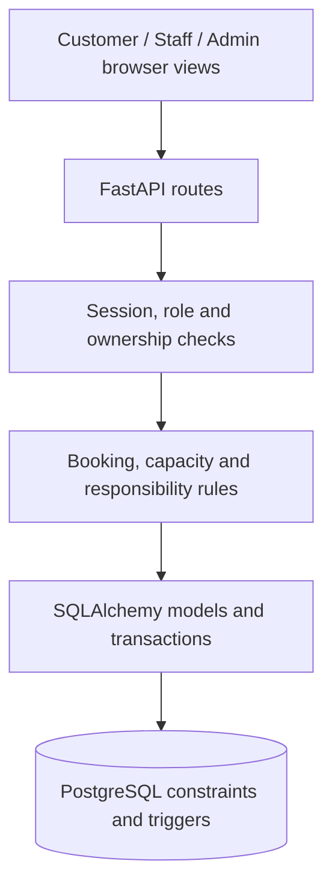

# Architecture

PetOps serves a plain HTML/CSS/JavaScript interface and role-scoped JSON APIs from one FastAPI application. SQLAlchemy maps relational records; Alembic maintains the PostgreSQL schema. No separate frontend build service is required.

| Responsibility | Source |
|---|---|
| Application entry point, login/logout and Customer APIs | [main.py](../../app/main.py) |
| Password hashing, sessions, role checks | [security.py](../../app/security.py) |
| Request validation | [schemas.py](../../app/schemas.py) |
| Booking transitions, events and resource checks | [services.py](../../app/services.py), [availability.py](../../app/availability.py) |
| Staff responsibility and handover periods | [responsibilities.py](../../app/responsibilities.py) |
| Grooming and Boarding operations | [grooming_routes.py](../../app/grooming_routes.py), [boarding_routes.py](../../app/boarding_routes.py) |
| Admin resource and account management | [resource_routes.py](../../app/resource_routes.py), [management.py](../../app/management.py) |
| Notifications and operational metrics | [notifications.py](../../app/notifications.py), [dashboard.py](../../app/dashboard.py) |
| Relational mapping and migrations | [models.py](../../app/models.py), [migrations](../../alembic/versions) |
| Browser interface | [static assets](../../app/static) |

The API is the authority for actions; hiding a button does not grant or revoke access. Database constraints and triggers also reject inconsistent writes that bypass API checks. PostgreSQL-specific concurrency guarantees are not established by SQLite fallback runs.

Sessions use random tokens with hashed server-side storage. Logout revokes the current session. Operational changes use transactions and attributed events. Scheduled reminders are a separate existing application job; the developer fixture disables automatic polling to keep demonstrations explicit.

The application uses Malaysia business dates/time. Planned responsibility is accountability for a booking, not an attendance or payroll model. See the [workflow boundaries](../workflows/README.md).
