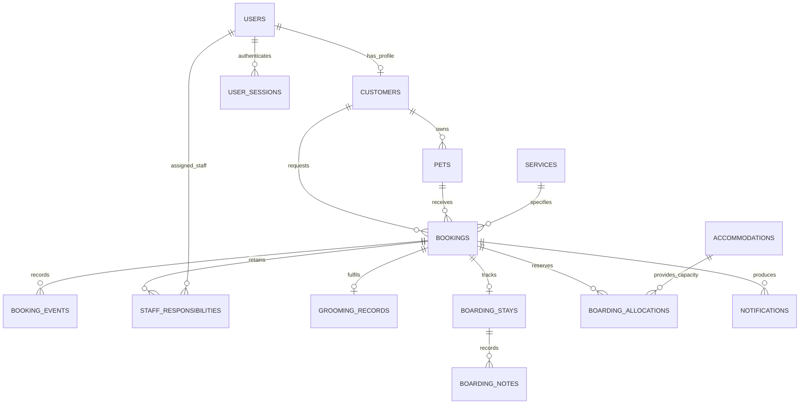

# Database model

The final schema has **17 application tables (149 fields)** at Alembic migration head **0008**:

- **Accounts and pets:** users, user_sessions, customers, pets.
- **Bookings and services:** services, bookings.
- **Staffing:** staff_responsibilities, staff_availability (legacy, read-only).
- **History and service records:** booking_events, grooming_records, boarding_stays, boarding_notes.
- **Accommodation:** accommodations, boarding_allocations.
- **Notifications and configuration:** notification_settings, notifications, management_events.

Foreign keys use `ON DELETE RESTRICT`, except for sessions. The final redesign did not change the schema.

The diagram below is a simplified portfolio ERD derived from [SQLAlchemy models](../../app/models.py) and the retained [migrations](../../alembic/versions). It omits secondary actor links, configuration tables, legacy compatibility fields and some attributes. It does not replace the actual schema.

| Design decision | Purpose / implementation |
|---|---|
| Composite Customer/Pet ownership links | Prevent a booking from linking another Customer's pet; `fk_booking_owned_pet` |
| Service type matches booking shape | Grooming uses appointment plus saved duration; Boarding uses start/end dates |
| Saved Grooming duration | Future service edits do not rewrite an existing appointment's duration |
| Separate physical allocation and Staff responsibility | Accommodation capacity and responsibility are different operational resources |
| Original and effective responsibility ends | Preserve what was recorded while attributing a subsequent handover |
| Append-only events and retained linked records | Preserve supported history; referenced records cannot be silently removed |
| PostgreSQL overlap and workflow checks | Reject conflicting assignments and invalid operational/history writes |

Boarding capacity considers overlapping reservations and physical occupancy; overdue open stays still occupy a place. Responsibility periods use half-open intervals. Initial Boarding responsibility is derived from the planned stay; general availability-window records are retained for compatibility but no longer control Staff eligibility.

The migration chain `0001`–`0008`, associated SQL and Alembic revision template are retained unchanged. Some upgrades are intentionally forward-only. A local developer database owner is suitable for the isolated setup guide; production runtime privileges require separate verification.

Examples of database-level tests are linked in the [traceability table](../analysis/README.md). This document describes implemented rules; it is not a new requirements baseline.
