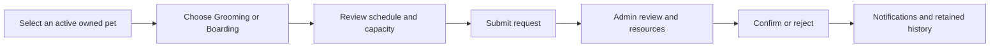

# Workflows and role boundaries

## Customer request

Customers can see their own bookings and history. Reschedule/cancel actions depend on the current state. Rescheduling revalidates the new schedule and invalidates resources that must be assigned or allocated again. A notification describes an event; the current booking remains the source of current status and permitted actions.

## Grooming

Requested → Admin assigns active, non-conflicting Staff → Confirmed → Start → In progress → Complete → Completed.

The appointment and saved service duration determine the responsibility period. Staff and Admin have bounded fulfilment actions; Grooming is not split or handed over after fulfilment starts. Late-running assigned work remains visible rather than disappearing when its planned period ends.

## Boarding

Requested → Admin allocates accommodation, optionally assigns Staff → Confirmed → Check In → Staying → Check Out → Completed.

Admin handles unassigned Boarding work. Stay notes and operational events retain their actor and time. Check Out releases physical allocation and completes the stay through the existing combined action. Old compatible lifecycle records remain readable.

For a stay with Staff responsibility, Admin can make a bounded handover now or at a future instant within the planned stay. The original period remains recorded; the effective ending and replacement responsibility are attributed. Current Staff can act, future Staff can inspect upcoming work, and a former assignment alone no longer grants current access. Open overdue stays retain the last responsible actor for checkout.

## Admin management

Admin reviews requests, resources, active operations and history; maintains Staff accounts, services and accommodations; and reviews operational counts. Staff deactivation is blocked by unresolved current/upcoming responsibility. Inactive services and archived pets keep their history but cannot be chosen for a new request.

Insights use explicit date bases: bookings by creation date, completions by recorded completion date, and changes by event date. Responsibility periods do not prove attendance, continuous care or historical productivity. The system does not infer financial results.

Source: [service rules](../../app/services.py), [responsibilities](../../app/responsibilities.py), [fulfilment routes](../architecture/README.md) and [migration 0008](../../alembic/versions/0008_rules.sql).
