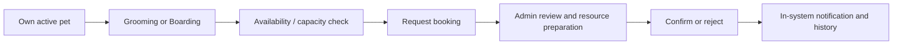

# Workflows and role boundaries

The interface shows the stored status SUBMITTED as **Requested**.

## Customer request

The booking journey has five steps: Type, Pet, Service, Date and time, Review. A preferred time or date is a **request** until Admin confirms it. Customers see only their own bookings, with a progress tracker, stay updates or groomer notes, and an activity timeline.

**Reschedule and cancel** are allowed only while a booking is Requested or Confirmed, by the Customer or Admin.
- Rescheduling returns the booking to Requested and releases the prepared groomer or place.
- Cancelling releases resources.

## Grooming

Requested → Admin assigns an eligible groomer and confirms → Confirmed → Start → In progress → Complete (optional notes) → Completed.

- **Eligibility:** an active Staff account with no overlapping unreleased responsibility. Generic availability windows are retired.
- **Confirmation:** requires a start time that has not passed.
- **Duration:** the appointment's duration is saved from the service at booking time.
- **Reassignment:** possible before work starts; there is no handover after work starts.
- **Admin fallback:** Admin can start and complete as a disclosed fallback.

## Boarding

Requested → Admin allocates accommodation with a free place every night (Staff optional) and confirms → Confirmed → Check in within the reserved dates → Staying → stay updates → Check out → Completed.

- **Check-out** completes the stay and releases the allocation. Admin handles stays with no assigned Staff.
- **Handover:** during an active stay, Admin can hand over responsibility now or at a future effective time. The original period stays on record.
  - Until the effective time, the current Staff member keeps both read and write access.
  - The incoming Staff member can view the work but can't act before the effective time.
  - Afterwards, the former Staff member is refused, including through old links.
- **Overdue stays:** an open stay past its planned check-out is labelled **Overdue stay** for visibility only. It keeps its place and its last responsible Staff member until check-out.

## Admin

- **Daily work:** review and decide requests, prepare resources, follow Today, the Boarding lodging board, Staff work and History.
- **Settings:** maintain Services, Staff accounts and Boarding setup (units and capacity). Configure Reminders, and review the Change log.
- **Staff deactivation:** refused while that person still has current or upcoming work.
- **History is kept:** inactive services and archived pets remain in history but can't be chosen for new requests.

Source: [services.py](../../app/services.py), [responsibilities.py](../../app/responsibilities.py), [grooming_routes.py](../../app/grooming_routes.py), [boarding_routes.py](../../app/boarding_routes.py), [0008 rules](../../alembic/versions/0008_rules.sql).
